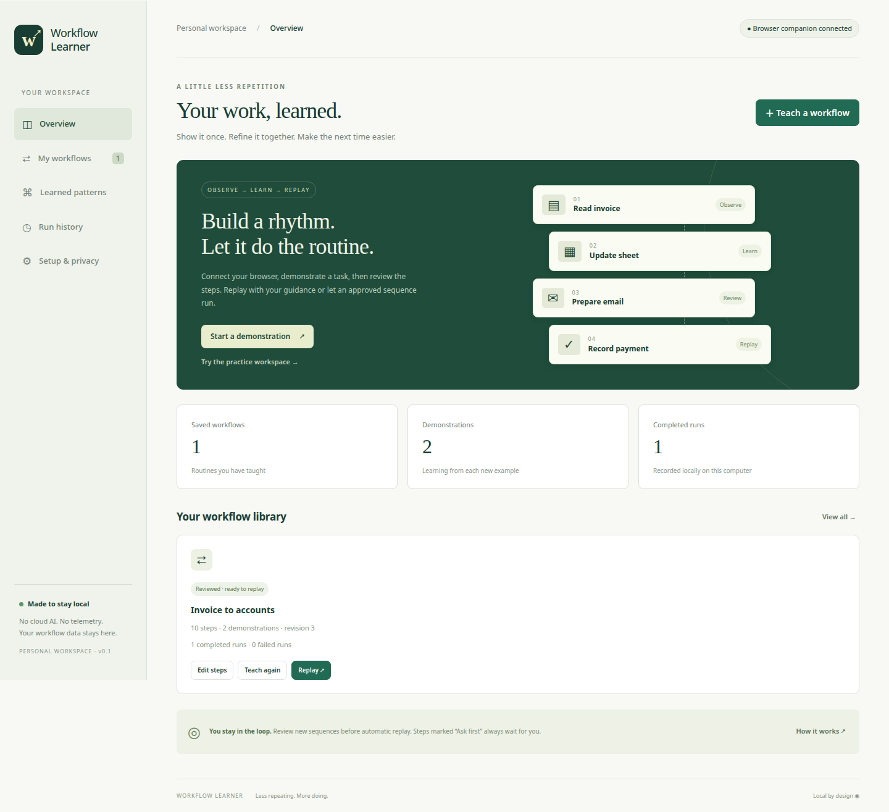

# Workflow Learner

A local application that learns demonstrated routines and replays them — guided, or fully automatic with no approvals. Use it to connect browser tasks such as invoices, spreadsheets, email drafts, and accounting screens into a visible, editable sequence.

**This is a working v0.2, not a universal autonomous employee.** It learns ordered actions and repeated subsequences; it does not train an AI model or infer business rules. Browser controls and supported Linux accessibility controls can be replayed. Apps without accessible controls need manual steps or a dedicated adapter.



## Your installation and current status

- **Project folder:** `/home/abdul-aleem-arshad-mohammed/Work/Workflow Learner`
- **Private GitHub repository:** https://github.com/abdulaleemarshad1979/workflow-learner
- **Local dashboard:** http://127.0.0.1:8765
- **Hosting:** local only. No Vercel deployment has been created, following your choice to keep it local.
- **Application menu:** search for **Workflow Learner**.
- **Background service:** starts at every login (`systemctl --user status workflow-learner`).
- **Browser setup:** load the companion extension in your own Brave profile once; it pairs itself.
- **Recording:** off until you explicitly start a demonstration.

A website hosted on Vercel cannot, by itself, watch or control your desktop apps. A future hosted interface would still require a running, paired local service. The current installation does not require Vercel, an API key, a paid AI subscription, or a cloud database.

## Start

Requires Python 3.11+ and Brave, Chrome, or another Chromium browser. Linux desktop integration additionally requires system Python with PyGObject and AT-SPI.

```bash
cd "/home/abdul-aleem-arshad-mohammed/Work/Workflow Learner"
./start.sh
```

For another checkout, run `./start.sh` from its directory. The first launch creates a virtual environment and installs dependencies. The dashboard opens at **http://127.0.0.1:8765**. Keep its terminal open while using the app; Ctrl+C stops the service. No recording starts automatically. If the app is already running, use the dashboard URL directly. Launching it a second time opens the existing workspace without changing its recorded data.

To keep it always running in the background (starts at login, restarts on failure; recommended for autopilot):

```bash
./scripts/install-autostart.sh
# stop:    systemctl --user stop workflow-learner
# remove:  systemctl --user disable --now workflow-learner
```

To add an application-menu launcher:

```bash
./scripts/install-desktop.sh
```

## Connect your everyday Brave browser

1. Open `brave://extensions` (Chrome: `chrome://extensions`).
2. Enable **Developer mode**, click **Load unpacked**, and select the repository's `extension` folder.
3. Done. The companion **pairs itself** within a few seconds; the dashboard header shows **● Browser companion connected** and the popup says **Connected**. No key to copy.
4. Reload the websites you want to record. Sign in before recording.

Already loaded an older copy? Click **Remove** on it, then **Load unpacked** again: v0.2 has a fixed extension ID (`ioonaammpiolcjejhgegdihpdplleanj`). The local app hands its key only to requests whose browser-enforced `Origin` is that ID, so websites cannot pair. Manual key pairing remains under the popup's *Manual pairing* fallback.

The extension operates in your existing browser profile, so you keep your normal accounts and sessions. It requests access to HTTP/HTTPS sites to support your different websites. The service-worker/content-script design follows [Chrome's isolated content-script model](https://developer.chrome.com/docs/extensions/develop/concepts/content-scripts).

Loading an unpacked extension and approving its browser permissions is a one-time browser setup step. The repository being installed does **not** mean the extension is already installed in your personal Brave profile.

## Teach → review → replay

1. Click **Teach a workflow**, give the routine a name, and optionally restrict it to exact origins such as `https://mail.google.com` and `https://docs.google.com`.
2. Optionally enable desktop observation. Recording continues until paused/stopped, with a 1,000-step limit per demonstration.
3. Perform one complete task in your normal browser. A red **REC** badge indicates active browser observation.
4. Click **Stop & save**. Open **Edit steps** and inspect the sequence. Remove incidental clicks or add manual instructions.
5. All captured text and select values become named `{{parameters}}`. Enter fresh values for each run. You can replace a parameter with an explicit fixed value in the editor.
6. Keep **Ask first** enabled for steps that send messages, post financial records, delete items, or otherwise need your review. All recorded clicks, checks, and shortcuts default to asking first; the app does not guess business impact from a button label.
7. Click **Replay ↗**. The default mode is **Bypass — fully automatic, no approvals**. Values you type are remembered for next time. **Automatic** (stops at Ask-first steps, needs review) and **Guided** (approve every step) remain available.
8. Use **Teach again** to capture a corrected demonstration. This creates a new revision, retains the old revision locally, and invalidates the prior review. Recurring sequences of 3–5 steps found in at least two saved demonstrations appear under **Learned patterns**.

## Fully automatic: Bypass mode and Autopilot

- **Bypass** runs every step — including send, submit, post, and delete — without asking, without the review gate, and skips manual note steps. The only stops are a failed step (missing control, changed website, no acknowledgement) and your **Stop** button on the run banner.
- **Autopilot** (button on each workflow card) runs a workflow by itself in Bypass mode: every N minutes (≥5), once a day at a time, or only when you press **Run now**. Save the input values once in the same dialog; they are stored locally (`inputs` in the SQLite file) and reused every run.
- Autopilot starts a run only when nothing else is recording or running, and waits for the Brave companion when the workflow has browser steps.
- If a scheduled run fails, autopilot **pauses itself** (shown in red on the card) instead of repeating a half-finished routine. Fix or re-teach, then press **Save** in the Autopilot dialog to resume.
- **Learned patterns → Save as workflow** turns a sequence seen in several demonstrations into a new workflow you can put on autopilot.

Bypass trades safety for speed: a wrong recording executes wrongly. Test new workflows once in Guided mode, and use Teach again when a website changes.

**Continuous learning means accumulating demonstrations while recording is on.** It does not mean hidden always-on screen capture. Pattern counts are evidence of repetition, not a safety score. A completed run means adapters acknowledged the recorded actions; verify the business result in the target application.

## Practice without touching your accounts

Click **Try the practice workspace** on the dashboard. While recording:

1. Enter an invoice number, customer, and amount; click **Add invoice to sheet**.
2. Enter a recipient and message; click **Save local draft**.
3. Tick the accounting checkbox and click **Finish practice workflow**.
4. Stop/save, review the steps, and replay with different values.

The practice workspace uses memory only. It never sends email, moves money, or updates external accounts. The screenshot shows test data from this exact flow.

## Your first real workflow: invoice → sheet → Gmail → accounting

Start with the practice workflow before working in real accounts. Then use this sequence:

1. Open Brave and sign into your invoice portal, spreadsheet, Gmail, and accounting website. Choose the correct account in each app.
2. Open the local dashboard in a separate tab and click **Teach a workflow**.
3. Name it, for example, **Customer invoice processing**. Optionally enter one website origin per line. An origin is the protocol and hostname, without a document path: `https://mail.google.com`.
4. Click **Start recording**, then switch to your work tabs. Complete just one invoice so the sequence has a clear beginning and end.
5. For a canvas-based sheet, attachment upload, download, or unsupported app, complete that part manually and add a **manual** step in the editor afterward. Do not assume the recorder captured invisible spreadsheet cells or file dialogs.
6. In Gmail, demonstrate preparing a draft first. If you include a Send action, leave its **Ask first** option enabled so every replay pauses before sending.
7. Return to the dashboard and click **Stop & save**.
8. Click **Edit steps**. Remove unrelated navigation and incidental clicks. Keep control labels aligned with the actual screen labels, because replay checks those labels.
9. Use **Guided** replay for the first real run. Fill the named parameters, approve one step at a time, and verify the target account and result in the app.
10. When the sequence is reliable, mark that revision reviewed. Use **Automatic** to run between Ask-first/manual checkpoints.
11. Use **Teach again** when the website or routine changes. Review the new revision before using automatic replay again.

The app does not currently extract data from invoices and infer how to transform it into spreadsheet rows. It records the steps; you supply replay inputs as parameters. Dedicated data extraction and business-system adapters would be separate features.

## Daily use

- **Begin work:** start the local app or open its already-running dashboard; check that the browser companion is connected.
- **Teach something new:** start a named demonstration, complete the task, then stop/save. It can keep observing within that session until you stop or reach 1,000 steps.
- **Protect a private interruption:** click **Pause** before switching to sensitive work. Click **Resume** when ready.
- **Run an existing routine:** click **Replay** (Bypass by default), adjust values or leave saved ones blank, and start. Or let **Autopilot** run it on schedule. Browser replay opens new tabs in the paired profile.
- **Help the app:** complete a manual step yourself, then click **I completed this step**. For an Ask-first step, inspect the destination and click **Approve this step**.
- **Stop a run:** click **Stop**. Previously completed actions remain completed; the app cannot undo them.
- **End the day:** stop/save any recording, stop unfinished replay, then close the local service terminal or press Ctrl+C. With `install-autostart.sh` the service keeps running for autopilot; recording still only happens when you start it.

## Parameters and step editing

A parameter looks like `{{invoice_number_a1b2c}}`. Names are generated from a control label plus a short selector identifier. The suffix distinguishes fields that share a label.

- Enter a new value for each parameter when starting a replay.
- To reuse one value across several steps, edit those steps to use the same parameter name, such as `{{customer_email}}`.
- To keep a constant, replace the placeholder with a fixed value. Fixed values are saved in the local database.
- A **select** parameter must be the HTML option value expected by the website; the visible option text may differ.
- A **check** step uses `true` or `false`.
- A **manual** step contains an instruction for you and never dispatches an automatic action.
- The advanced JSON editor exposes the full step list, including tab identifiers, embedded-frame URLs, and desktop application metadata. Use it only when necessary; incorrect selectors or frame mappings cause replay to stop.
- Save changes with **Save revision**, then review the new version before automatic mode. Saving does not run anything.

## Troubleshooting

| What you see | What to do |
|---|---|
| Dashboard will not open | Run `./start.sh` from the project folder; check that its terminal stays open. Use `http://127.0.0.1:8765`, not an HTTPS URL. |
| Port 8765 already in use | An instance may already be running. Open the dashboard. If another program owns that port, stop that program before launching Workflow Learner. |
| Browser companion not connected / OFF badge | Check `systemctl --user status workflow-learner`, that the extension is enabled, and that it is v0.2 (ID `ioonaammpiolcjejhgegdihpdplleanj`; remove and Load unpacked again if not). |
| Autopilot paused | The last scheduled run failed; the card shows the error. Fix the workflow, then Save in the Autopilot dialog. |
| Desktop workflow did nothing | Clicks in the GNOME dock/overview are skipped on replay (they are transient). Make sure the recording contains an **Open …** (`native_launch`) step for the app. |
| Recording contains no browser steps | Reload your work tabs after installing the extension, wait a couple of seconds after starting recording, and check the origin allowlist. Browser internal pages and login screens are excluded. |
| A field did not record | Password/private fields are excluded. Canvas/shadow widgets and file uploads are not generally supported. Add a manual step or use a dedicated adapter. |
| Automatic mode is unavailable | Open the workflow, inspect its current revision, then mark it reviewed. Editing or teaching again resets review. |
| Replay is waiting | It is in Guided or Automatic mode at a checkpoint. Use Bypass to never wait. |
| Control not found, label changed, or ambiguous target | Stop, inspect the current site, and teach or edit the affected step. The app will not guess another target. |
| Keyboard step needs manual completion | Replace Enter/shortcut behavior with an explicit button click or a manual step. |
| Desktop adapter unavailable | Verify system Python can import PyGObject and AT-SPI. On Debian/Ubuntu, the packages are `python3-gi` and `gir1.2-atspi-2.0`. |
| Control '…' not found uniquely | Replay first tries the recorded accessibility path, then a unique role/name match, waiting up to 10 s for a just-launched app. If the app's layout changed, Teach again. Apps without accessibility support require manual operation. |
| Command timed out / acknowledgement lost | Inspect the target app first: it may already have performed the action. Do not blindly rerun a send/post/payment step. |
| Website accepts typed values but ignores replay | Some apps require trusted input, rich editing protocols, or specialized integrations. Use a manual step for that action. |
| A run was interrupted after restart | The app intentionally does not resume side effects after a restart. Review what already happened before starting again. |

## Updates, backup, and removal

To update from your private GitHub repository, stop the local service first, then:

```bash
cd "/home/abdul-aleem-arshad-mohammed/Work/Workflow Learner"
git pull --ff-only
.venv/bin/python -m pip install -r requirements-lock.txt
.venv/bin/python -m pip install --no-deps -e .
./start.sh
```

After extension source changes, click **Reload** for Workflow Learner on `brave://extensions`, then reload the websites you use.

To back up your work, stop the local service and copy the entire `~/.local/share/workflow-learner` folder to a location you control. It contains private workflow metadata and pairing keys; do not publish it to GitHub. Restore the whole folder with the app stopped, retain private permissions, and restart. Keep the project source separately in GitHub.

To remove the tool, stop it, remove the Workflow Learner browser extension, remove the project folder, and remove the `workflow-learner.desktop` launcher from `~/.local/share/applications` if desired. Delete the data folder only if you want to erase your saved workflows as well. No OS login autostart service was installed.

## Desktop apps

The optional adapter uses the [GNOME AT-SPI accessibility interface](https://gnome.pages.gitlab.gnome.org/at-spi2-core/libatspi/index.html), including on compatible Wayland applications. It observes accessible focus changes and text-edit locations, without reading the typed text.

- Where an accessible application maps uniquely to an installed desktop launcher, a reviewed `native_launch` step can open it.
- `native_focus` focuses a uniquely matching role/name within the recorded application.
- `native_fill` fills a matching editable control using a parameter.
- To activate an accessible button, change its observed focus step to `native_action`; only controls with exactly one accessible action can run.
- Native button activation is **not** universally observable, so focus events are not automatically promoted to clicks.
- If a control is absent or ambiguous, replay stops. Duplicate role/label pairs need a dedicated adapter or a manual step.

On Debian/Ubuntu, install `python3-gi` and `gir1.2-atspi-2.0` if the adapter reports unavailable. Other Linux distributions may use different package names. macOS/Windows native adapters are not implemented; the browser companion remains the primary capture route.

## Current coverage and limits

| Capability | v0.1 |
|---|---|
| Existing Brave/Chrome profile | Browser extension; one paired browser profile at a time |
| Multi-tab navigation | Captured and recreated in new tabs |
| Standard DOM clicks, inputs, textareas, selects, checkboxes | Record and replay |
| Contenteditable fields such as many email editors | Basic text replay; rich formatting/attachments require review |
| Embedded frames | Exact frame URL matching; ambiguous/missing frames stop replay |
| Repeated demonstrations / workflow revisions | Stored locally and mined for ordered subsequences |
| Guided, automatic, Bypass, scheduled Autopilot | Implemented; Bypass/Autopilot run with no approvals |
| Linux desktop app focus/text/actions | AT-SPI adapter; application dependent |
| Google Sheets canvas, Excel grids, drag-and-drop, file dialogs, downloads, shadow DOM | Manual steps or custom adapters needed |
| Keyboard shortcuts / Enter submissions | Observed; replace with a button click or manual step for replay |
| Arbitrary app understanding, invoice OCR, local LLM inference, autonomous triggering | Not implemented |
| Gmail/Zoho/Tally business correctness | Must be demonstrated and verified with your own app; no dedicated integration claimed |

Website selectors and labels can change. Replay verifies a unique visible control and its recorded label; it stops instead of choosing a nearby or similar target. Some sites reject synthetic DOM events. Use a manual step when an app requires trusted input or a specialized integration.

## Privacy and storage

- The HTTP server binds only to `127.0.0.1:8765`.
- Workflows, demonstrations, revision history, and execution outcomes live in `~/.local/share/workflow-learner`. Override with `WORKFLOW_LEARNER_DATA` if desired.
- The data directory uses permissions `0700`, and the database/key file uses `0600`. Data is **not encrypted at rest**; use your OS disk encryption if needed.
- No cloud AI, telemetry, screenshots, clipboard capture, or global keystroke logger.
- Password/OTP/payment-card fields identified by type/attributes/labels are excluded. Login/OAuth pages are excluded. URL query keys matching common secret names and token-bearing fragments are removed.
- **URLs, control labels, and explicit fixed values can still contain personal data.** Automatic redaction cannot recognize every custom secret field. Pause recording for sensitive work; use an origin allowlist. Website authors can also mark private areas `data-wl-private`.
- Recorded input values become placeholders before storage; replay parameter values live in memory and are not written to run logs. Values you explicitly save into workflow steps are persisted.
- Browser login sessions remain in your browser's existing profile. The extension stores its scoped pairing token in extension storage.
- The adapter key may submit events and acknowledge commands; it cannot approve a run, edit/delete workflows, or read the full library. The dashboard has a separate admin token.
- Host validation and Fetch Metadata checks restrict access from other websites. This is a single-user local tool, not a security boundary against malicious processes or other users with access to your OS account.
- Delete a workflow to remove its associated demonstrations, revisions, and run history from the live database. This is ordinary deletion, not guaranteed forensic erasure of disk/WAL/backups.
- Runtime data, credentials, virtual environments, and logs are excluded from Git.

## Failure behavior

Only one recording or replay is active at a time. Each command is dispatched at most once. A missing acknowledgement fails the run after 45 seconds; it is not automatically retried because the application might already have performed the action. Stop/pause cannot undo an action already dispatched. Inspect the target app before starting a new run after an error.

Restarting the service marks unfinished work interrupted and never resumes side effects automatically. Nothing is sent to your contacts or posted to accounting software during installation or tests.

## Development and verification

```bash
python3 -m venv .venv
.venv/bin/python -m pip install -e '.[dev]'
.venv/bin/python -m pytest -q
.venv/bin/ruff check workflow_learner tests scripts
.venv/bin/python -m playwright install chromium
.venv/bin/python scripts/browser_smoke.py
# Optional Linux desktop test: opens a temporary, isolated GTK window.
.venv/bin/python scripts/native_smoke.py
```

The browser smoke test uses a temporary profile and database. It pairs the real MV3 extension, records two invoice demonstrations, discovers repeated patterns, replays with fresh parameters, verifies the resulting sheet/draft/accounting state, checks the step editor, and checks mobile overflow. It requires port 8765 to be free. Extension testing uses the [Playwright Chromium extension workflow](https://playwright.dev/python/docs/chrome-extensions).

`requirements-lock.txt` records the runtime environment used for this release; `requirements-dev-lock.txt` records test tools. CI runs the backend tests, lint/format checks, JavaScript syntax checks, and browser smoke test. The GTK smoke test requires an accessibility-enabled desktop and is run separately.

Design targets for this personal tool are local API p95 under 150 ms for a small library, dashboard LCP under 1.5 s / INP under 200 ms / CLS under 0.1 on a local connection, and 99% availability while the user-run process and computer are awake. These are targets, not measured production SLOs or guarantees.

## Project layout

```text
workflow_learner/     Local API, SQLite storage, sequence learner, replay engine
  native.py          Optional Linux accessibility adapter
  static/            Dashboard and isolated practice workspace
extension/           Brave/Chrome MV3 companion
scripts/             Launch setup and real browser/desktop smoke tests
tests/               State-machine, privacy, authentication, and API tests
```
